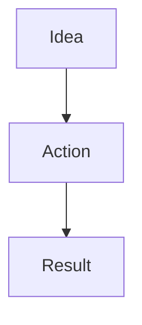

# Amos Note Workspace

一个部署在 **Cloudflare Workers + Workers KV** 上的轻量个人笔记工作台。它在原项目的单 Worker 架构上升级了界面、文档整理、阅读、编辑和格式检查能力，不要求单独部署 Node.js 服务或数据库。

## 本次升级内容

- **全新 Amos 品牌界面**：原创内嵌 SVG Logo、浏览器标签图标、动态渐变背景、居中登录卡片和响应式布局。
- **笔记组织**：原有列表视图保留，新增卡片视图；支持拖拽调整顺序，也保留上下移动、重命名、删除和创建笔记。
- **内容搜索**：可搜索标题，也可点击 Search 搜索所有笔记的正文内容，并显示匹配片段。
- **工作区皮肤**：Ocean、Rose、Aurora、Amber 四种工作区配色。阅读模式额外提供 Linen、White、Warm、Gray、Midnight、Sage 纸张主题，阅读宽度、字体与字号选项。
- **阅读与编辑**：阅读控件收纳在可展开的悬浮面板里；编辑器支持 Markdown 工具栏、实时预览、延迟自动保存、手动保存和 `Ctrl/Cmd + S`。
- **格式检测**：Detect formatting 检查常见标题/列表空格、未闭合行内反引号、代码围栏和数学围栏；可定位问题行并高亮提示。Auto-fix 只处理常见且相对安全的格式问题，应用前会确认。
- **丰富渲染**：支持 GitHub 风格 Markdown、常规 HTML 标签（经过 HTML 清理）、LaTeX 数学公式、Mermaid 图表，以及代码块复制。
- **数据结构兼容**：不迁移、不重命名原有 KV key，不改变标题数组与正文文本格式。

## 部署前的重要兼容说明

应用继续使用原项目的 Cloudflare KV 数据结构：

| KV Key | 存储格式 | 用途 |
|---|---|---|
| `titles` | JSON 字符串数组，例如 `["Note A", "Note B"]` | 保存标题与顺序 |
| `doc:<encodeURIComponent(title)>` | 原始文本字符串 | 保存对应笔记正文 |

例如标题为 `My Note` 的正文依然保存在 `doc:My%20Note`，标题列表依然保存在 `titles`。新版本没有执行任何自动迁移或批量改写。

**升级时请务必继续绑定原先的同一个 KV Namespace。不要新建空 Namespace 后直接替换原绑定，也不要手动删除 `titles` 或 `doc:*` 键。** 建议部署前在 Cloudflare Dashboard 中为关键数据做好备份。

## Cloudflare Dashboard 部署

1. 进入 Cloudflare Dashboard → **Workers & Pages**，打开现有 Worker（或创建一个新的 Worker）。
2. 使用模块化 Worker 脚本，将本项目的 `_workers_webtext.js` 全部内容复制到 Worker 的编辑器中并保存。
3. 在 Worker → **Settings → Bindings** 中添加 **Workers KV namespace**：
   - Variable name：`CONTENT_KV`
   - Namespace：选择当前保存笔记的那个既有 KV Namespace。
4. 在 **Settings → Variables and Secrets** 中添加 `PASSWORD`。可设为明文密码；程序会在服务端计算 SHA-256。也可使用 64 位十六进制 SHA-256 字符串。
5. 可选添加 `SECRET` 作为 Session 签名密钥。若不配置，则使用 `PASSWORD` 对应的 SHA-256 值作为签名密钥。
6. 可选添加 `SESSION_TTL_SECONDS` 作为登录有效期（秒）；默认 86400 秒，即 24 小时。程序会把有效期限制在 60 秒至 30 天之间。
7. 点击 **Deploy**，通过 Worker 的 HTTPS 地址访问并登录。

`CONTENT_KV` 是必须的 binding。生产环境务必配置非空的 `PASSWORD`，并确保通过 HTTPS 访问。

## 使用 Wrangler 部署

仓库提供 `wrangler.toml.example` 作为配置模板。复制为 `wrangler.toml`，把 `id` 替换为现有 KV Namespace ID；若要原 Worker 原位升级，还要把 `name` 改成当前线上 Worker 的实际名称。不要把示例占位 ID 用于实际部署。

```bash
cp wrangler.toml.example wrangler.toml
# 编辑 wrangler.toml，填写现有 KV Namespace ID
npx wrangler secret put PASSWORD
# 根据提示输入登录密码
npx wrangler secret put SECRET
# 可选：配置独立的 Session 签名密钥
npx wrangler deploy
```

也可以在 Cloudflare Dashboard 中设置环境变量。`PASSWORD` 和 `SECRET` 建议使用 Secret，而不是提交进 Git 仓库的明文配置。

## 使用方法

### 登录与主题

打开 Worker 地址输入密码。登录后在 **Note Workspace** 标题下方选择 Ocean、Rose、Aurora 或 Amber，工作区会记住选择的主题。

### 创建和管理笔记

在创建栏输入标题并选择 **Create note**。List view 以传统行列表显示，Card view 以卡片展示。卡片和列表记录都能拖拽调整顺序，也可以用 ↑ / ↓ 调整；顺序保存回原来的 `titles` 数组。Read 打开阅读模式，Edit 打开编辑模式。重命名会迁移同一篇笔记正文的 key；删除会删除标题和对应正文，操作前会要求确认。

### 搜索

直接输入标题可以即时筛选。点击 **Search**（或在输入框按 Enter）会进一步搜索笔记正文，并在匹配记录下显示正文片段。

### 编辑与预览

编辑工具栏可插入标题、粗体、斜体、代码、引用、表格、链接、图片、清单、任务清单、LaTeX 和 Mermaid 模板。编辑时会显示实时预览，约 1.6 秒无输入后自动保存；也可点 **Save now** 或使用 `Ctrl + S` / `Cmd + S` 手动保存。

### 格式检测与修复

从 GPT、Gemini 或其他工具复制内容后，切换到编辑模式并点击 **Detect formatting**。检测器会对常见问题行加底色，并列出行号；点击问题可以跳转定位。**Auto-fix safe issues** 可修正常见标题/列表空格，并尝试补齐未闭合的代码或数学围栏。应用前会出现确认提示。自动检测只能覆盖常见问题，无法代替对复杂 Markdown 方言、HTML 结构或数学表达式的人工检查。

### 阅读风格

阅读界面的右下角水滴形按钮可以打开悬浮工具。支持纸张主题 Linen、White、Warm、Gray、Midnight、Sage，并可调整阅读宽度、衬线/无衬线字体与字号。这些显示偏好保存在当前浏览器本地，不会更改 KV 笔记正文。

### HTML、LaTeX 与 Mermaid

- HTML：普通 HTML 片段可与 Markdown 混用。输出会通过 DOMPurify 进行清理，脚本和危险属性不会被允许执行，因此不保证任意脚本型 HTML 都能按原样运行。
- LaTeX：支持常见的 `$...$`、`$$...$$` 数学写法。
- Mermaid：在代码围栏指定 `mermaid`，例如：

````markdown

````

公式、Mermaid、Markdown 样式和 HTML 清理库从 jsDelivr CDN 加载；Marked、DOMPurify、KaTeX 与 marked-katex-extension 的 URL 已固定到明确版本，Mermaid 使用 11.x 主版本。浏览器需要能访问相应 CDN；若网络或内容拦截器屏蔽这些资源，对应的增强渲染可能不可用，但正文仍保存在 KV 中。

## KV 数据与兼容性细节

- `titles` 仍是 JSON 序列化的字符串数组。
- 每份正文仍以纯文本写入 `doc:<encodeURIComponent(title)>`，并未转换成 JSON、HTML 或新版本对象。
- 新的显示模式、主题、阅读宽度、字体与字号保存在浏览器 `localStorage`，不改变云端 KV schema。
- 新版保护了笔记列表和正文的 API 读取端点，必须拥有有效 Session 才能读取；正常网页访问登录后会自动携带 HttpOnly Cookie。
- Session Cookie 名称为 `wksess`，默认期限 24 小时。若更换 `SECRET` 或密码，原有登录 Session 可能失效，需要重新登录；笔记数据不受影响。

## 安全及运行说明

- 请设置强密码和独立的 `SECRET`，只通过 HTTPS 使用。
- 即使 HTML 输出经过清理，也请把笔记正文中的外部图片、链接和嵌入内容视为不可信来源。
- 此应用面向个人/小规模笔记；Workers KV 有最终一致性特征，不适合多用户同时编辑同一份文档的强一致性协作场景。
- 页面使用第三方 CDN 提供 Markdown、KaTeX、Mermaid、DOMPurify 等前端库。若需要完全离线或不依赖第三方 CDN 的部署，需要将这些依赖自行打包为 Worker Assets 并调整加载路径。

## 项目文件

```text
webtext-main/
├── _workers_webtext.js   # Worker 后端 + 内嵌 HTML/CSS/JS
├── README.md             # 本说明
└── wrangler.toml.example # Wrangler 配置模板
```

## 故障排查

- **登录失败**：确认 `PASSWORD` 值正确；如果填写的是 SHA-256，必须是 64 位十六进制字符串。
- **笔记列表为空**：确认 `CONTENT_KV` 绑定的是旧版本使用的 Namespace，而不是新建的空 Namespace。
- **无法保存**：打开浏览器开发者工具检查请求；确认 Session 尚未过期，并确认 KV binding 正常。
- **公式或图表不显示**：确认浏览器能够访问 jsDelivr，检查浏览器控制台是否有脚本加载错误，以及公式/图表围栏是否闭合。
- **自动修复未发现问题**：检测器针对常见格式错误，不会解析所有 Markdown 扩展或修复语义不明确的结构。保存前请先查看实时预览。
